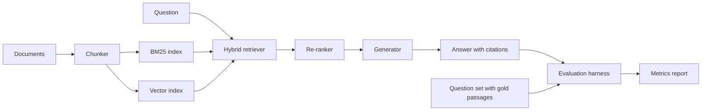
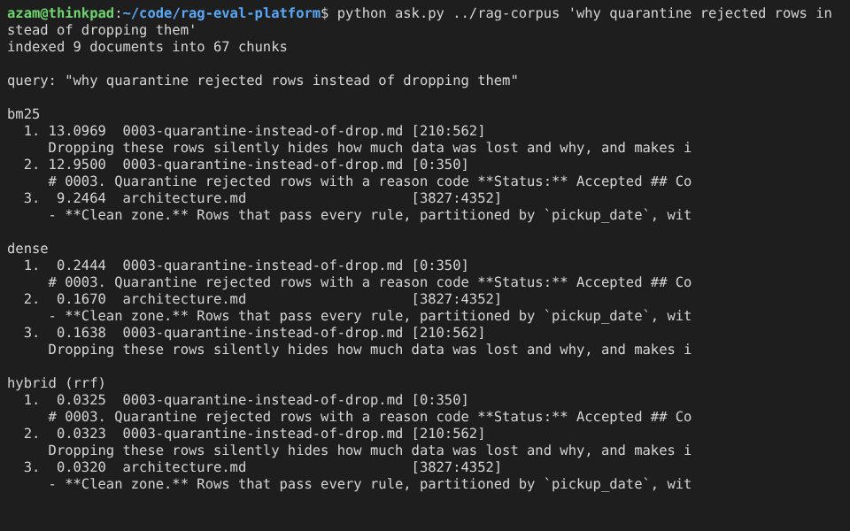

# rag-eval-platform

[](https://github.com/mohammadazam7/rag-eval-platform/actions/workflows/ci.yml)

Retrieval-augmented question answering over a document collection, with answers that cite
their sources, and an evaluation harness that measures whether a change to chunking,
retrieval or generation made the system better or worse.

> **Status:** early development. The project foundation is in place; see the
> [roadmap](docs/ROADMAP.md) for milestone dates. Results will be published here only
> once they have been measured.

## Overview

Most RAG prototypes are tuned by reading a handful of answers and deciding they look
right. This project treats the pipeline as a system under test. Every stage is a
swappable component with a fixed interface, and every configuration is scored on the
same question set with the same metrics, so two configurations can be compared on
numbers rather than impressions.

## Architecture



| Component | Responsibility |
|---|---|
| Chunker | Split documents into passages with stable IDs and character offsets back into the source |
| Retriever | BM25 and dense retrieval, fused with reciprocal rank fusion |
| Re-ranker | Rescore the top candidates with a more expensive model |
| Generator | Produce an answer constrained to the retrieved passages, citing passage IDs; a deterministic local stub backs the tests |
| Evaluation harness | Retrieval recall@k and MRR against gold passages; answer faithfulness and hallucination rate; side-by-side comparison of configurations |

## Design decisions

- **Stable passage identity.** A passage ID is derived from the document ID and the
  character span, so a citation remains valid across re-indexing as long as the source
  text does not change.
- **Offsets, not copies.** Each chunk records its character span in the source document.
  Citations can then be traced back to exact text, and faithfulness checks compare an
  answer against the original passage rather than a normalized copy.
- **Deterministic tests.** The generator interface has a local stub that produces
  reproducible output, so the unit and integration tests never call a hosted model.

## Getting started

```bash
python -m venv .venv && source .venv/bin/activate
make install
make check
```

## Example: three retrievers, one query

`examples/ask.py` indexes a folder of Markdown and prints the top three chunks from BM25,
the dense retriever and their reciprocal rank fusion, each with its document and the
character span it came from. Run on the architecture docs and decision records of
[nyc-taxi-data-lake](https://github.com/mohammadazam7/nyc-taxi-data-lake):

```bash
python examples/ask.py path/to/docs "why quarantine rejected rows instead of dropping them"
```



BM25 ranks the decision record's rationale first on exact terms; the dense retriever
prefers its title and summary. Fusion puts both chunks of the record at the top, ahead
of the architecture note, which neither retriever ranked first. The dense model here is
the dependency-free hashing baseline, so the gap between the two is about lexical
overlap rather than meaning; a sentence-transformer embedder plugs into the same
interface in a later milestone.

## License

MIT
