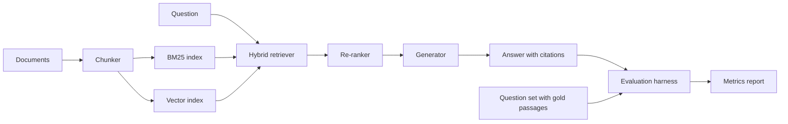
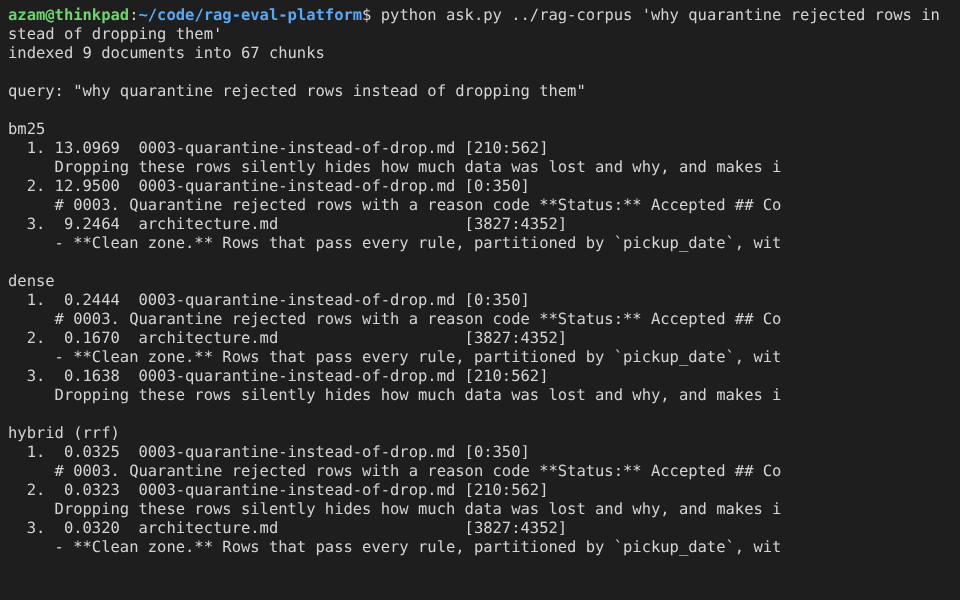

# rag-eval-platform

[](https://github.com/mohammadazam7/rag-eval-platform/actions/workflows/ci.yml)

Retrieval-augmented question answering over a document collection, with answers that cite
their sources, and an evaluation harness that measures whether a change to chunking,
retrieval or generation made the system better or worse.

> **Status:** in development. Chunking, retrieval, re-ranking, cited answers and the
> evaluation harness are in place, with measured results on a public corpus below. The
> HTTP service is next. See the [roadmap](docs/ROADMAP.md) for milestone dates.

## Overview

Most RAG prototypes are tuned by reading a handful of answers and deciding they look
right. This project treats the pipeline as a system under test. Every stage is a
swappable component with a fixed interface, and every configuration is scored on the
same question set with the same metrics, so two configurations can be compared on
numbers rather than impressions.

## Architecture



| Component | Responsibility |
|---|---|
| Chunker | Split documents into passages with stable IDs and character offsets back into the source |
| Retriever | BM25 and dense retrieval, fused with reciprocal rank fusion |
| Re-ranker | Rescore the top candidates with a more expensive model |
| Generator | Produce an answer constrained to the retrieved passages, citing passage IDs; a deterministic local stub backs the tests |
| Evaluation harness | Retrieval recall@k and MRR against gold passages; answer faithfulness and hallucination rate; side-by-side comparison of configurations |

## Results: FastAPI tutorial benchmark

44 questions over the 51 Markdown files of the FastAPI tutorial (MIT licence, pinned to
one upstream commit): 36 with a verbatim gold quote and 8 the tutorial cannot answer.
Every row uses the same 80 token sentence chunks, the top 4 chunks and the extractive
backend, so the rows differ only in retrieval. Mean with 95% bootstrap interval.

| Configuration | recall@5 | MRR | nDCG@10 | Correct abstention | ms per question |
|---|---|---|---|---|---|
| BM25 | 0.81 [0.67, 0.92] | 0.63 [0.51, 0.75] | 0.71 [0.60, 0.80] | 0.75 [0.61, 0.89] | 9.3 |
| Dense (hashing, 512) | 0.53 [0.36, 0.69] | 0.42 [0.28, 0.57] | 0.48 [0.35, 0.62] | 0.70 [0.57, 0.84] | 1.1 |
| Hybrid (RRF) | 0.75 [0.61, 0.89] | 0.52 [0.40, 0.65] | 0.60 [0.48, 0.72] | 0.70 [0.57, 0.84] | 9.7 |
| Hybrid + re-rank | 0.67 [0.50, 0.81] | 0.56 [0.43, 0.69] | 0.63 [0.51, 0.75] | 0.61 [0.48, 0.75] | 13.2 |

Measured on x86_64 with 2 vCPUs, Python 3.13, one process. Full table with citation and
grounding metrics: [benchmarks/fastapi-tutorial/RESULTS.md](benchmarks/fastapi-tutorial/RESULTS.md).

What the numbers say:

- On short reference prose where questions reuse the documentation's own terms, BM25
  is the strongest single retriever. The hashing embedder is a lexical baseline, not a
  learned model, and fusing it with BM25 costs ranking quality instead of adding it.
- The intervals are wide at 44 questions. Hybrid and BM25 overlap on every metric, so
  the honest conclusion is "no evidence hybrid helps here", not "hybrid is worse".
- Re-ranking moves gold chunks up (MRR and nDCG rise over plain hybrid) but the
  extractive backend then answers fewer answerable questions (20 of 36, against 24 for
  plain hybrid and 25 for BM25), because it keeps only 4 chunks and the re-ranker trades
  recall@5 for order. BM25 abstained on all 8 unanswerable questions; both hybrid rows
  answered one of them.

Reproduce:

```bash
./benchmarks/fastapi-tutorial/fetch_corpus.sh
python benchmarks/fastapi-tutorial/run.py
```

## Run it as a service

```bash
pip install -e ".[service]"
RAG_EVAL_DATA_ROOT=data/raw uvicorn "rag_eval.service:create_app" --factory
curl -X POST localhost:8000/corpora/fastapi-tutorial
curl -X POST localhost:8000/corpora/fastapi-tutorial/ask \
  -H "Content-Type: application/json" \
  -d '{"question": "When do background tasks run?", "retriever": "bm25"}'
```

Open `http://localhost:8000/` to see the answer next to the passages it was built from,
with the cited ones marked. `POST /corpora/{name}/evaluate` runs the same harness as
`benchmarks/fastapi-tutorial/run.py` on questions you send in the request.

## Design decisions

- **Stable passage identity.** A passage ID is derived from the document ID and the
  character span, so a citation remains valid across re-indexing as long as the source
  text does not change.
- **Offsets, not copies.** Each chunk records its character span in the source document.
  Citations can then be traced back to exact text, and faithfulness checks compare an
  answer against the original passage rather than a normalized copy.
- **Deterministic tests.** The generator interface has a local stub that produces
  reproducible output, so the unit and integration tests never call a hosted model.

## Getting started

```bash
python -m venv .venv && source .venv/bin/activate
make install
make check
```

## Example: three retrievers, one query

`examples/ask.py` indexes a folder of Markdown and prints the top three chunks from BM25,
the dense retriever and their reciprocal rank fusion, each with its document and the
character span it came from. Run on the architecture docs and decision records of
[nyc-taxi-data-lake](https://github.com/mohammadazam7/nyc-taxi-data-lake):

```bash
python examples/ask.py path/to/docs "why quarantine rejected rows instead of dropping them"
```



BM25 ranks the decision record's rationale first on exact terms; the dense retriever
prefers its title and summary. Fusion puts both chunks of the record at the top, ahead
of the architecture note, which neither retriever ranked first. The dense model here is
the dependency-free hashing baseline, so the gap between the two is about lexical
overlap rather than meaning; a sentence-transformer embedder plugs into the same
interface in a later milestone.

## Example: cited answers

`examples/answer.py` runs the whole pipeline: hybrid retrieval, the term-proximity
re-ranker over 30 candidates, a prompt with the top 4 passages labelled `[P1]` to `[P4]`,
and the deterministic extractive backend. Each citation resolves to a document and
character span. Same corpus as above:

```text
$ python examples/answer.py path/to/docs "why quarantine rejected rows instead of dropping them" \
    "how are late arriving records handled" "which cloud region hosts the warehouse"

Q: why quarantine rejected rows instead of dropping them
A: Rejected rows go to the quarantine zone with the first reason code they break; the codes
   are part of the contract because quality checks group by them [P4]. Quarantine rejected
   rows with a reason code [P3].
   [P4] architecture.md [3827:4352]
   [P3] adr/0003-quarantine-instead-of-drop.md [0:350]

Q: how are late arriving records handled
A: There is no incremental or late-arriving-data path beyond re-running a month [P3].
   [P3] architecture.md [7085:7282]

Q: which cloud region hosts the warehouse
A: I don't know.
```

The third question has no answer in the corpus, and the backend abstains rather than
quoting the closest passage. The extractive backend only quotes, so its citations are
correct by construction; it is the reference a model backend is measured against in
milestone 4, where citation precision and abstention on unanswerable questions are
scored over a question set.

## License

MIT
