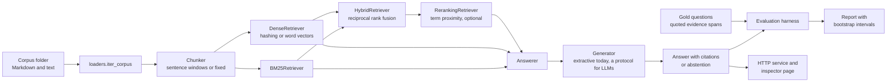

# Architecture

## Pipeline

Every retriever implements one protocol, `search(query, k) -> [(chunk, score)]`, so
the answerer, the harness and the service accept any of them, and a new retriever needs
no change anywhere else.

## Modules

| Module | Responsibility |
|---|---|
| `loaders` | Read a corpus folder into documents with stable ids (path relative to the root) |
| `chunking` | Split documents into chunks that keep their character offsets into the source |
| `retrieval` | BM25, reciprocal rank fusion, the hybrid retriever |
| `embeddings` | Hashing and word vector embedders, exact inner-product dense search |
| `index_store` | Save and load a dense index with a checksum so a stale index is refused |
| `rerank` | Term proximity re-ranking over a deeper candidate list |
| `prompting`, `generation` | Numbered context, cited answers, label checking, abstention |
| `answering` | Retrieve, re-rank, generate: one call per question |
| `evaluation` | Gold sets on quoted spans, metrics, the harness and the Markdown report |
| `service` | FastAPI app: index, ask, evaluate, inspector page |

## Why chunks keep offsets

Gold evidence is a quoted span of a document, resolved to character offsets once. A
chunk counts as relevant when its offsets overlap a gold span. Because chunks keep
their offsets, one gold set scores any chunking strategy, and changing the chunk size
never invalidates the questions.

## What is measured where

- Retrieval metrics (recall, precision, nDCG, MRR) come from the retriever's own
  ranking, independent of how many chunks the answerer keeps.
- Answer metrics (citation precision, supported sentences, hallucination, abstention)
  come from the final answer.
- Every number is reported with a bootstrap interval over questions, so two
  configurations are only called different when their intervals say so.
